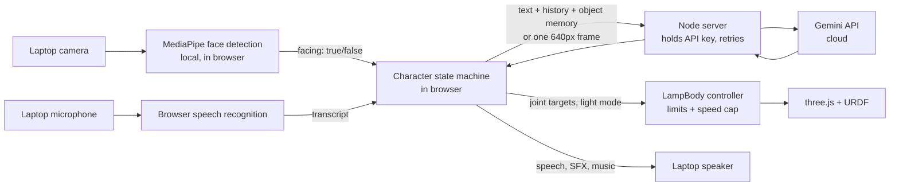

# Lamp Character

A live, expressive character built around the supplied five-DOF desk lamp. It watches through the laptop camera, listens through the microphone, talks through the speaker, and moves and glows in a three.js simulation of the URDF.

Stack: JavaScript, three.js + urdf-loader, MediaPipe face detection (local), WebAudio, browser speech APIs, a small Node/Express server, and Google Gemini (free tier) for language and vision.

## The five moments

| Moment | How it works | Main file |
|---|---|---|
| Engagement | MediaPipe finds a face and checks the nose sits between the eyes (facing the screen). Timers decide when to notice, greet, and disengage. | `perception.js`, `character.js` |
| Character response | Notice: head lift and a two-note chime. Greeting: a bounce, brighter light, a jingle, then a soft music bed. | `character.js`, `poses.js`, `sound.js` |
| Spoken interaction | Browser speech recognition in, Gemini reply, browser speech out. Light and pose change for listening, thinking, and speaking. | `voice.js`, `character.js` |
| Scene memory | "Look at this" sends one camera frame to Gemini and gets back JSON (object, color, details, position). The result is stored with a timestamp and added to later prompts, so questions about it are answered from the saved record. | `character.js` |
| Goal-directed action | A spoken goal ("point at the remote") plus one camera frame go to Gemini, which returns a short plan made only of menu actions. The body validates and runs them. | `character.js`, `robot.js` |

## Setup (Ubuntu 24.04)

1. **Node 20 or newer.** Ubuntu 24.04's default `nodejs` package is version 18, which is too old for `--env-file`.
   ```bash
   curl -fsSL https://deb.nodesource.com/setup_20.x | sudo -E bash -
   sudo apt install -y nodejs
   ```
2. **Google Chrome**, not Chromium or the snap build. The app uses the browser's built-in speech recognition, which Chromium builds typically do not include.
3. **A free Gemini API key** from https://aistudio.google.com/app/apikey. Copy `.env.example` to `.env` and fill it in:
   ```
   GEMINI_API_KEY=your-key
   GEMINI_MODEL=gemini-flash-lite-latest
   ```
4. Install and run (two terminals):
   ```bash
   npm install
   node --env-file=.env server.js     # terminal 1, leave it running
   npm run dev                        # terminal 2
   ```
5. Open the address Vite prints (usually http://localhost:5173) in Chrome, click **Start**, and allow the camera and microphone.

The API key lives only in the server process. The browser never sees it.

### Demo script

1. Look at the lamp. It notices, then greets you (bounce, jingle, music).
2. Chat for a turn or two.
3. Hold an object up and say "look at this".
4. Put it away and ask what you showed it earlier.
5. With an object in view, say "point at the remote" (use the object's name).
6. Look away for a few seconds. It disengages and the music fades.

---

# Technical note

## Architecture and data flow



**What runs where.** Engagement is decided locally: camera frames used for face detection never leave the browser. The cloud sees only: (a) the text of what the person said plus the conversation so far, on every turn; (b) one 640 px JPEG, only when the person asks the lamp to look at something or gives a pointing goal. Chrome's speech recognition also sends microphone audio to Google's servers. Gemini's free tier may use requests to improve Google products, which is worth knowing before showing it anything private.

**Why this split.** Face presence has to be fast, constant, and private, so it stays local. Language and open-ended vision need a large model and are only needed on demand, so they go to the cloud. This also fits the target laptop (4 cores, 8 GB, no GPU), since the only constant local workload is a small face detector.

## Protocol and model-to-action boundary

The model never controls the body directly. It can only return JSON from a fixed menu:

- `{"action":"aim","x":0..1,"y":0..1}`: a point in the camera picture
- `{"action":"light","mode":"dim|normal|bright|spot"}`: a preset
- `{"action":"wait","seconds":0..3}`

The browser code checks every step. Unknown actions are ignored, coordinates are clamped to 0..1, at most four steps run, and light modes map to fixed presets. The model's output is treated as untrusted input; it is also parsed defensively because it sometimes wraps JSON in code fences.

An aim point becomes joint targets in `aimAt()`: image x maps to base yaw and image y to head pitch, using an assumed 1.1 rad horizontal field of view. The spoken reply after a goal is a fixed template filled in by my code (with the model's label for the target), so the lamp cannot narrate actions that were never sent to the body. It does not yet verify the result; see limitations. The chat persona is also told it cannot move on its own in ordinary conversation, to stop it describing movements that never happened.

Body and character live in the same browser process, so the "protocol" is a function call (`setPose`, `setLight`). On real hardware I would keep the same two calls and put them behind a small WebSocket service.

## Simulation and physical constraints

The URDF is loaded with urdf-loader and driven by a controller (`LampBody`) that holds a target for each joint and moves toward it every frame. It enforces:

- the URDF **soft limits** (from `safety_controller`), not the hard limits
- a speed cap of **80% of each joint's URDF velocity limit**
- easing toward the target, so there are no instant jumps

The pose helper `armPose(lower, upper)` expresses arm leans as reach, because the head joint's 180 degree origin makes raw signs confusing. The light is a spotlight on `light_emitter_link`, plus a glow on the shade.

Not modeled: dynamics, torque or effort limits, collisions, and self-collision. Motion is kinematic only.

## Deployment

Target: Ubuntu 24.04, 4 cores, 8 GB, no GPU, Wi-Fi. The large models run in the cloud, so the laptop only runs a small CPU face detector (MediaPipe's short-range model), the 3D scene, and a tiny Node server. Chrome is required for speech recognition. Camera, microphone, and speaker are used through the browser, which talks to the standard Linux camera and audio devices, so no extra drivers are needed. Without a network the lamp can still notice, greet, and disengage, but it cannot hear or answer. If a cloud call fails mid-conversation it apologizes out loud and goes back to listening. It currently runs through the Vite dev server in two terminals; a production build served by Express plus a systemd unit would be the next step for an unattended install. On a real lamp I would keep engagement and joint limits on the device, as they are here, and treat the cloud as optional.

## Key design choices

| Choice | Why | Tradeoff |
|---|---|---|
| Everything in the browser, plus a thin server | One page gives camera, mic, speaker, 3D, and audio. The server only keeps the key private and handles retries. | Browser speech APIs are cloud-backed and Chrome-only in practice. |
| One state machine owns the character | Perception only reports attention; the state machine decides all motion, light, and sound, so the behaviors feel connected. | Timers need tuning by hand. |
| Timers for engagement (0.3 s notice, 1 s greet, 1.5 s lose-notice, 2.5 s disengage) | Stops flicker and walk-bys from triggering greetings. | Adds a small delay to reactions. |
| Keyword matching for "look at this" and goals | Free, instant, no extra API call. | Unusual phrasing is missed. |
| Fixed action menu | Safe, testable, and easy to explain. | The model cannot do anything outside the menu. |
| Server retries, then falls back to a second model | Google returned 503 "high demand" errors during testing. | Fallback answers may differ slightly. |

## Measurements

**Response latency** is the time from the speech recognizer returning a transcript to the lamp's voice starting. One session of 29 turns, Chrome on a Windows laptop, free Gemini tier. Turn types were sorted by hand from the console log.

| Turn type | Turns | Median | Fastest | Slowest |
|---|---|---|---|---|
| Chat | 20 | 4.1 s | 2.5 s | 22.5 s |
| Look at this | 3 | 5.0 s | 4.1 s | 10.1 s |
| Pointing goal | 6 | 6.5 s | 3.9 s | 11.9 s |

Starting speech adds a steady 0.7 s on top of the model call. Most of the spread comes from the model call, which ranged from about 1.8 s to 21.7 s on chat. I suspect free-tier load, since the server logged retries during this period. Two of the six goal turns returned "not found" because I said "point to this" without naming the object.

**Engagement reliability.** Thresholds: nose-to-eye-midpoint offset under 0.35 of eye distance, and face width above 10% of frame width.

- Looking at the lamp: 10 of 10 reached the greeting within 2 s
- Looking away or walking past: 3 of 10 caused a false greeting
- Unwanted drops to disengaged during conversation: none

**CPU and memory**

- Idle, face detection running: 1.5 % CPU
- During a conversation: 75 % CPU

I have not run this on the Ubuntu target, so these numbers come from a different machine.

## Known limitations

- Goal-directed action does not take a second look before reporting success. It plans from one frame, runs the steps, and reports. This falls short of the brief.
- The real camera cannot see the simulated beam, and it is not mounted on the lamp head, so even a re-check could confirm only the target's position, not the beam's.
- The aim mapping uses a guessed field of view and no calibration.
- "Point at this" is ambiguous because the lamp cannot see a pointing finger. Naming the object works.
- Intent detection is keyword-based.
- Speech recognition ends at the first pause and sometimes drops the start of a sentence.
- Free-tier rate limits and outages cause slow or failed replies.
- Handles one person; not tested with several faces.
- Not tested on Ubuntu 24.04 or in a production build; it runs through the Vite dev server.

## Completed and left out

Completed: engagement and disengagement, greeting with motion, light, sound effects, and music, spoken conversation, scene memory with recall, and goal-directed pointing from a planned action sequence.

Partly done: goal-directed action plans and executes, but does not re-observe the scene before reporting.

Left out on purpose: calibrating the camera to the lamp, a wake word, multiple people, local speech and language models, a transcription fallback for browsers without speech recognition, and a packaged build.